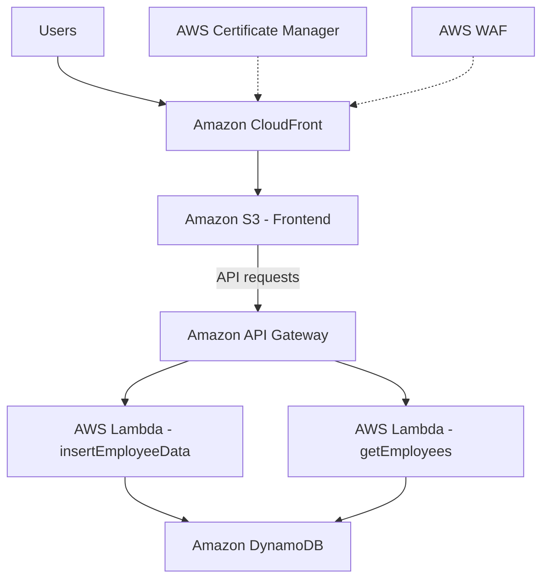

# CloudNative Employee Platform

A serverless, cloud-native employee management application built using AWS managed services.

## Project Overview

This project demonstrates a serverless application architecture using Amazon S3, Amazon CloudFront, Amazon API Gateway, AWS Lambda, and Amazon DynamoDB.

The frontend is hosted on Amazon S3 and delivered through CloudFront, with AWS Certificate Manager and AWS WAF integrated for secure web delivery.

The backend uses API Gateway to expose REST API endpoints, AWS Lambda to process employee operations, and DynamoDB to store employee records.

## Architecture

## AWS Services Used

- **Amazon S3** – Static frontend hosting.
- **Amazon CloudFront** – Content delivery.
- **AWS Certificate Manager (ACM)** – SSL/TLS certificate management.
- **AWS WAF** – Web application protection.
- **Amazon API Gateway** – REST API endpoints with GET and POST methods.
- **AWS Lambda** – Serverless backend processing.
- **Amazon DynamoDB** – NoSQL employee data storage.
- **AWS IAM** – Permissions and execution role management.

## Backend Functions

| Lambda Function | Purpose |
|---|---|
| insertEmployeeData | Inserts employee records into DynamoDB |
| getEmployees | Retrieves employee records from DynamoDB |

## Database

- Database: Amazon DynamoDB
- Table: `employeeData`
- Partition Key: `employeeid`

## Security and Access Management

- Configured an IAM execution role for Lambda.
- Integrated AWS WAF with the CloudFront delivery layer.
- Configured an ACM certificate for HTTPS delivery.

## Implementation Highlights

- Built a serverless frontend and backend architecture.
- Hosted the frontend using Amazon S3.
- Integrated CloudFront for content delivery.
- Exposed backend functionality through API Gateway.
- Implemented employee data operations using AWS Lambda.
- Stored employee records in DynamoDB.
- Configured IAM permissions for Lambda and DynamoDB access.

## Project Status

The application architecture was implemented and tested. 

