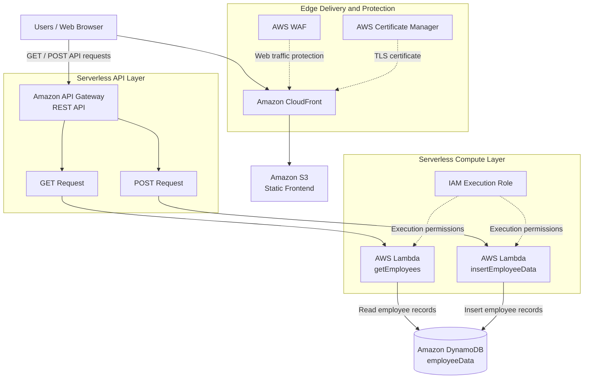

# CloudNative Employee Platform

A serverless employee management platform built on AWS, combining static frontend delivery, managed API services, event-driven compute, and NoSQL data storage.

The platform uses **Amazon S3, Amazon CloudFront, AWS WAF, AWS Certificate Manager, Amazon API Gateway, AWS Lambda, and Amazon DynamoDB** to deliver a cloud-native application without managing traditional application servers.

---

## Project Overview

The CloudNative Employee Platform demonstrates how to design and deploy a serverless, API-driven application using managed AWS services.

The frontend is hosted on Amazon S3 and distributed through Amazon CloudFront. Users interact with employee records through a REST API exposed by Amazon API Gateway. AWS Lambda processes incoming requests and communicates with Amazon DynamoDB for persistent data storage.

### Key Capabilities

- Serverless frontend and backend architecture
- Global content delivery through Amazon CloudFront
- HTTPS support using AWS Certificate Manager (ACM)
- Web application protection using AWS WAF
- REST API integration with GET and POST methods
- Event-driven backend processing with AWS Lambda
- Persistent employee data storage using Amazon DynamoDB
- IAM-based permissions for Lambda execution

---

## Architecture



### Architecture Flow

1. A user accesses the frontend through the CloudFront distribution.
2. CloudFront retrieves and delivers static frontend content hosted in Amazon S3.
3. AWS WAF provides web application protection, while ACM provides the certificate used for HTTPS.
4. The browser sends employee-related GET and POST requests to the API Gateway REST API.
5. API Gateway invokes the corresponding Lambda function.
6. Lambda processes the request and interacts with the DynamoDB table.
7. The API returns the response to the browser.

---

## AWS Services and Responsibilities

| AWS Service | Responsibility |
|---|---|
| Amazon S3 | Hosts static frontend assets |
| Amazon CloudFront | Distributes frontend content |
| AWS WAF | Provides web application protection |
| AWS Certificate Manager | Manages the HTTPS certificate |
| Amazon API Gateway | Exposes REST API endpoints |
| AWS Lambda | Executes backend application logic |
| Amazon DynamoDB | Stores employee records |
| AWS IAM | Controls Lambda execution permissions |

---

## Backend Implementation

### API Gateway

An Amazon API Gateway REST API acts as the entry point for backend operations.

| HTTP Method | Backend Function | Purpose |
|---|---|---|
| GET | `getEmployees` | Retrieves employee records |
| POST | `insertEmployeeData` | Inserts employee records |

### AWS Lambda

Two Lambda functions handle the application's backend operations.

**1. `getEmployees`**

- Invoked through the GET API method.
- Communicates with DynamoDB.
- Retrieves employee records.
- Returns the API response.

**2. `insertEmployeeData`**

- Invoked through the POST API method.
- Receives employee information.
- Writes employee records to DynamoDB.
- Returns the operation response.

### Amazon DynamoDB

The application uses a DynamoDB table named:

`employeeData`

**Table configuration:**

- Table name: `employeeData`
- Partition key: `employeeid`

DynamoDB provides managed NoSQL storage for employee information.

---

## Security Architecture

Security is implemented using multiple AWS services and identity-based permissions.

| Component | Security Role |
|---|---|
| AWS WAF | Web application traffic protection |
| AWS Certificate Manager | HTTPS certificate management |
| AWS IAM | Lambda execution permissions |
| Amazon CloudFront | Secure content delivery over HTTPS |

**IAM configuration note:** The Lambda execution role used during implementation had the AWS-managed `AmazonDynamoDBFullAccess` policy attached. This provides broad DynamoDB permissions and is not a least-privilege configuration.

A production deployment should replace broad permissions with a custom IAM policy granting only the specific DynamoDB actions and resources required by each function.

---

## Technology Stack

- **Cloud Platform:** Amazon Web Services (AWS)
- **Frontend Hosting:** Amazon S3
- **Content Delivery:** Amazon CloudFront
- **Web Application Security:** AWS WAF
- **Certificate Management:** AWS Certificate Manager
- **API Management:** Amazon API Gateway (REST API)
- **Backend Compute:** AWS Lambda
- **Database:** Amazon DynamoDB
- **Identity and Access Management:** AWS IAM

---

## Project Scope

| Component | Implementation Status |
|---|---|
| S3 frontend hosting | Implemented |
| CloudFront distribution | Implemented |
| AWS WAF integration | Implemented |
| ACM certificate integration | Implemented |
| API Gateway REST API | Implemented |
| Lambda backend functions | Implemented |
| DynamoDB integration | Implemented |
| IAM execution role | Implemented |
| Route 53 DNS configuration | Not implemented |

---

## Potential Enhancements

The following improvements can extend the platform:

- Configure Amazon Route 53 for custom domain routing.
- Implement least-privilege IAM policies for Lambda functions.
- Add Amazon CloudWatch dashboards, metrics, and alarms.
- Introduce automated deployment using AWS SAM or Terraform.
- Add authentication and authorization using Amazon Cognito.
- Implement automated testing and CI/CD pipelines.

---

## Repository Structure

```text
CloudNative-Employee-Platform/
│
├── README.md
│
├── architecture/
│   ├── architecture-diagram.md
│   └── architecture-overview.md
│
├── infrastructure/
│   ├── frontend-hosting.md
│   ├── api-gateway.md
│   ├── lambda-functions.md
│   ├── dynamodb-design.md
│   └── security-configuration.md
│
├── documentation/
│   ├── implementation-guide.md
│   └── troubleshooting.md
│
└── screenshots/
    ├── frontend/
    ├── cloudfront/
    ├── api-gateway/
    ├── lambda/
    ├── dynamodb/
    └── security/
```

---

## Learning Outcomes

Through this project, I gained practical experience with:

- Designing a serverless application architecture on AWS.
- Integrating managed AWS services across multiple application layers.
- Configuring CloudFront for frontend content delivery.
- Building REST API integrations using API Gateway and Lambda.
- Connecting serverless compute with DynamoDB.
- Understanding IAM execution roles and permission boundaries.
- Applying foundational cloud security and deployment concepts.

---

**Project:** CloudNative Employee Platform  
**Category:** Cloud Computing | Serverless Architecture | AWS  
**Status:** Implemented and tested
