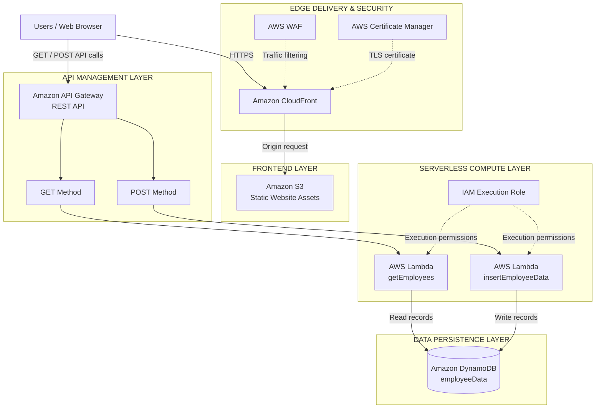
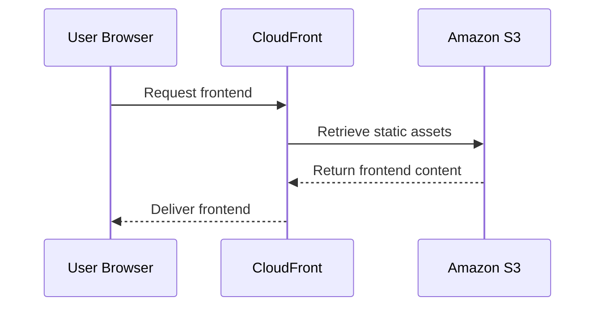
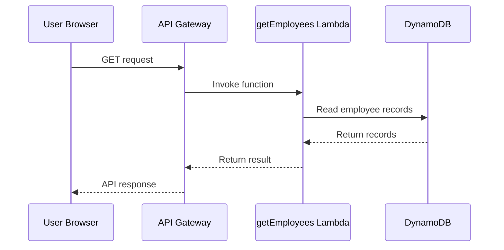
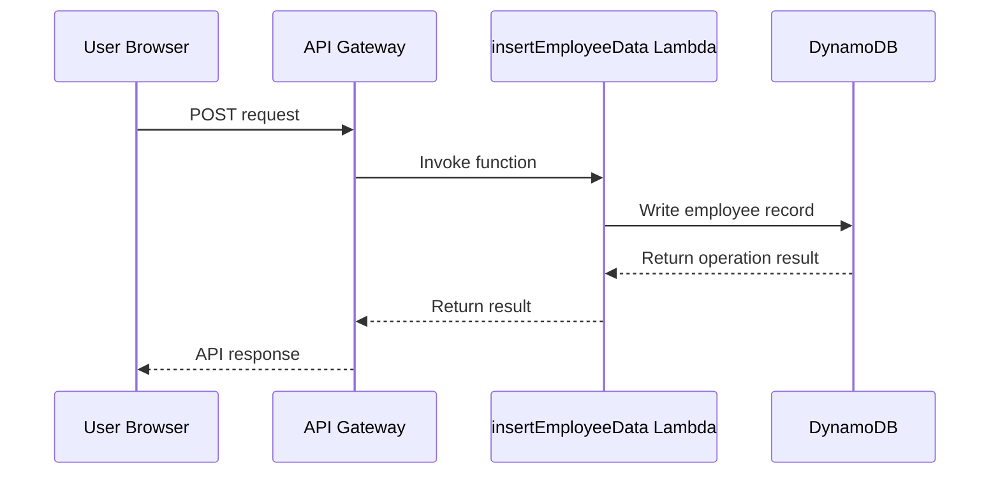

# CloudNative Employee Platform — Architecture Diagram

## 1. High-Level Architecture

The following diagram illustrates the logical architecture and service interactions of the application.

## 2. Request Flow

### Frontend Delivery

### Employee Data Retrieval

### Employee Data Insertion

## 3. Component Responsibilities

| Component | Function |
|---|---|
| CloudFront | Frontend content distribution |
| S3 | Static frontend hosting |
| WAF | Web application traffic protection |
| ACM | HTTPS certificate management |
| API Gateway | REST API entry point |
| Lambda | Backend request processing |
| DynamoDB | Employee data persistence |
| IAM | Backend execution permissions |

## 4. Architecture Notes

- Frontend delivery and API processing are separate request paths.
- The browser communicates with CloudFront for frontend assets.
- The browser communicates directly with API Gateway for employee operations.
- Lambda functions access DynamoDB using their execution role.
- Route 53 is not included because it was not implemented in this project.

**Diagram scope:** This represents the logical service architecture. It does not claim unverified VPC, subnet, origin access control, or network-isolation configurations.
