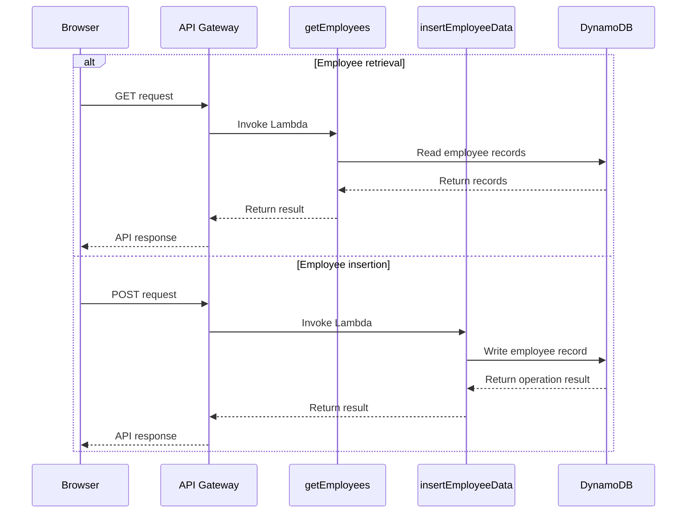

# API Gateway — REST API Configuration

## 1. Overview

Amazon API Gateway provides the API management layer for the CloudNative Employee Platform.

It exposes REST API endpoints that allow the frontend application to communicate with the serverless backend. API Gateway receives HTTP requests and invokes the corresponding AWS Lambda function.

## 2. Architecture Position

```text
User Browser
     |
     | GET / POST
     v
Amazon API Gateway
     |
     +----------------------+
     |                      |
     v                      v
GET Method              POST Method
     |                      |
     v                      v
getEmployees          insertEmployeeData
     |                      |
     +----------+-----------+
                |
                v
         Amazon DynamoDB
```

## 3. API Methods and Integrations

The application uses two HTTP methods.

| HTTP Method | Lambda Integration | Operation |
|---|---|---|
| GET | `getEmployees` | Retrieve employee records |
| POST | `insertEmployeeData` | Insert employee records |

### GET Method

The GET method handles employee retrieval requests.

**Execution flow:**

1. The frontend sends a GET request to the API endpoint.
2. API Gateway receives the request.
3. API Gateway invokes `getEmployees`.
4. Lambda retrieves employee records from DynamoDB.
5. The function returns the result through API Gateway.

### POST Method

The POST method handles employee insertion requests.

**Execution flow:**

1. The frontend submits employee information.
2. The browser sends a POST request to the API endpoint.
3. API Gateway receives the request.
4. API Gateway invokes `insertEmployeeData`.
5. Lambda processes the request and writes the record to DynamoDB.
6. The function returns the operation result through API Gateway.

## 4. API Request Lifecycle



## 5. Frontend Integration

The frontend communicates directly with the API Gateway endpoint.

The API endpoint is used by the frontend JavaScript to perform employee operations.

The request path is:

**Frontend → API Gateway → Lambda → DynamoDB**

The frontend hosting path remains separate:

**Browser → CloudFront → S3**

This separation keeps static content delivery independent from backend API execution.

## 6. Backend Integration

API Gateway integrates with two Lambda functions:

| Function | Responsibility |
|---|---|
| `getEmployees` | Reads employee records |
| `insertEmployeeData` | Writes employee records |

The Lambda execution role provides the permissions required for the functions to interact with DynamoDB.

## 7. Security Considerations

API Gateway is the public-facing backend entry point.

Important production improvements include:

- Configure authentication and authorization.
- Apply request validation to incoming payloads.
- Configure appropriate CORS policies for the frontend origin.
- Use throttling and request limits.
- Enable API logging and monitoring.
- Restrict backend permissions through least-privilege IAM policies.

These are recommended improvements and should not be interpreted as already implemented unless verified in the AWS configuration.

## 8. Implementation Scope

Implemented:
- Amazon API Gateway REST API.
- GET method integration.
- POST method integration.
- Lambda backend integrations.
- Frontend-to-API communication.

Potential enhancements:
- API authentication and authorization.
- Request schema validation.
- API usage plans and throttling.
- CloudWatch monitoring and alarms.
- Automated API deployment.

## 9. Summary

Amazon API Gateway provides a managed REST API layer between the frontend and backend. It routes GET and POST requests to dedicated Lambda functions, which interact with DynamoDB to retrieve and insert employee records.
