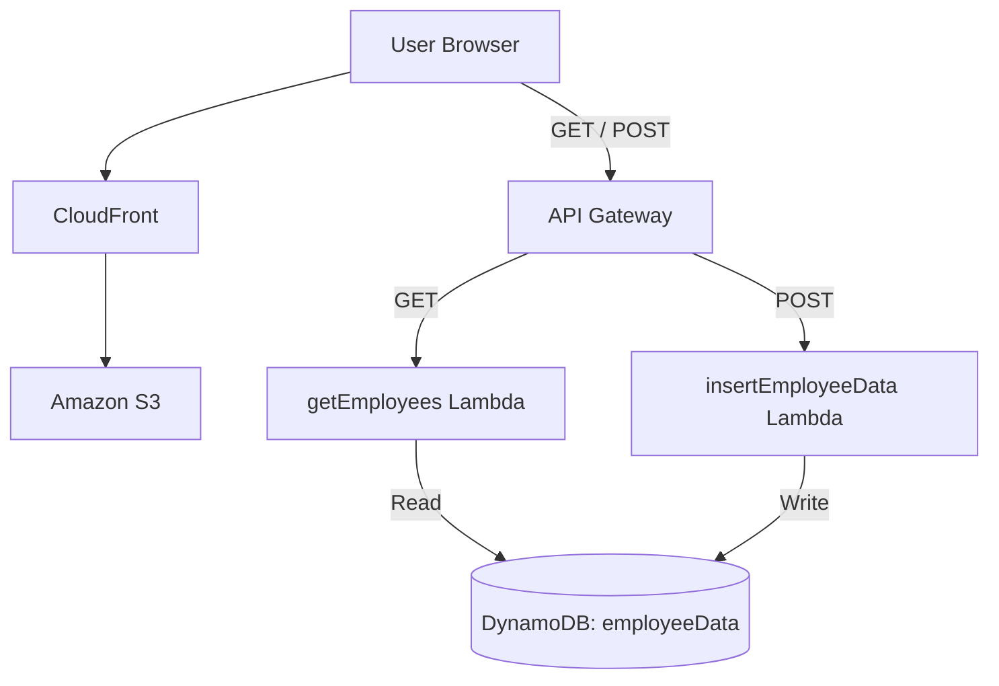

# Infrastructure Implementation Details

## 1. Overview

This document describes the AWS services configured to implement the CloudNative Employee Platform.

The application uses managed AWS services to deliver frontend content, process API requests, execute backend logic, and store employee records.

## 2. Frontend Infrastructure

| AWS Service | Implementation |
|---|---|
| Amazon S3 | Hosts static frontend files |
| Amazon CloudFront | Distributes frontend content |
| AWS WAF | Provides web application protection |
| AWS Certificate Manager | Manages the HTTPS certificate |

**Frontend request flow:**

Browser → CloudFront → S3

## 3. API Infrastructure

**Amazon API Gateway (REST API)** provides the backend API entry point.

Two HTTP methods are configured:

| Method | Lambda Function | Operation |
|---|---|---|
| GET | `getEmployees` | Retrieves employee records |
| POST | `insertEmployeeData` | Inserts employee records |

The frontend browser sends requests directly to the API Gateway endpoint.

## 4. Serverless Backend

AWS Lambda executes the application's backend operations without requiring dedicated application servers.

**`getEmployees`**
- Handles employee retrieval requests.
- Reads records from DynamoDB.
- Returns the result through API Gateway.

**`insertEmployeeData`**
- Handles employee insertion requests.
- Processes incoming employee information.
- Writes records to DynamoDB.

## 5. Database Configuration

Amazon DynamoDB stores the employee information.

| Configuration | Value |
|---|---|
| Database | Amazon DynamoDB |
| Table name | `employeeData` |
| Partition key | `employeeid` |
| Data model | NoSQL |

The Lambda functions communicate with DynamoDB using their IAM execution permissions.

## 6. IAM and Security

The project uses an IAM execution role named `serverless-lambda-role`.

The role is associated with the Lambda functions and provides DynamoDB permissions.

**Current configuration note:** The role uses the AWS-managed `AmazonDynamoDBFullAccess` policy. This is broader than necessary for the application's operations.

A future improvement would be to implement custom least-privilege policies for the required DynamoDB actions.

The project also integrates AWS WAF and AWS Certificate Manager into the frontend delivery architecture.

## 7. Complete Application Flow

## 8. Implementation Summary

| Component | Status |
|---|---|
| S3 frontend hosting | Implemented |
| CloudFront distribution | Implemented |
| AWS WAF integration | Implemented |
| ACM certificate integration | Implemented |
| API Gateway REST API | Implemented |
| Lambda functions | Implemented |
| DynamoDB integration | Implemented |
| IAM execution role | Implemented |
| Route 53 | Not implemented |

## 9. Future Improvements

- Configure Route 53 for custom domain routing.
- Implement least-privilege IAM policies.
- Add CloudWatch monitoring and alarms.
- Introduce Terraform or AWS SAM for infrastructure automation.
- Implement CI/CD deployment pipelines.
- Add authentication and authorization.

---

**Project:** CloudNative Employee Platform  
**Platform:** Amazon Web Services  
**Architecture:** Serverless | API-driven | Cloud-native
